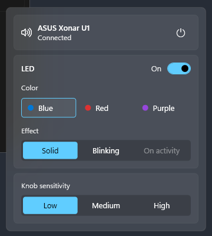

# ASUS Xonar U1 on Windows 11: volume knob and LED control

ASUS dropped support for the Xonar U1 USB sound card. Sound still plays on Windows 11, but the volume knob does nothing and the LED flashes nonstop while audio plays.

This small app fixes that, with no driver to install.

- **Volume knob works:** turn it to change the Windows volume, press it to mute.
- **LED under control:** turn it off, or pick blue, red or purple, solid or blinking.
- **Knob sensitivity:** low, medium or high.
- **Real card name:** Windows shows "ASUS Xonar U1" instead of "USB Advanced Audio Device".
- **Starts with Windows:** set it up once and forget it.

## Install

1. Download **[XonarU1-Setup.exe](https://github.com/Igloczek/asus-xonar-u1-windows/releases/latest/download/XonarU1-Setup.exe)**.
2. Run it. If Windows says it protected your PC, click **More info**, then **Run anyway**. That appears because this free app isn't code-signed.
3. Approve the admin prompt if Windows shows one. It's used once, to set the card's name.

That's it. The panel opens straight away, and the knob works. The new card name appears the next time you plug the card in or restart.

To change settings later, click the ring icon in the system tray. It may be hidden under the `^` arrow.

To update, download and run the latest version the same way.

## Uninstall

Go to **Settings → Apps → Installed apps**, find **XonarU1 for ASUS Xonar U1**, and choose **Uninstall**.

## Good to know

- **Supported card:** Xonar U1 with USB ID `0B05:1743`, tested on Windows 11. You can check the ID in Device Manager. The `0B05:1739` version isn't supported yet.
- **Volume steps:** the knob moves the volume 2% at a time, the same as keyboard volume keys, and controls your default output.
- **Purple looks mostly red:** both LEDs are on, but the red one is much stronger.
- **Unplugging during a game:** some apps stay silent after the card comes back. Windows moves them to another output and doesn't move them back, so restart the app. Browsers recover on their own.
- **"On activity" LED:** only the red LED can react to audio, so this effect isn't available for blue.

## Credits

Built on the protocol work of [xonard](https://github.com/alexp-sssup/asus-xonar-u1-utils) by Alessandro Pignotti and Stephane Albert. Not affiliated with ASUS. Licensed under [GPL-3.0](LICENSE).
